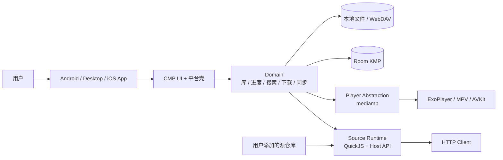
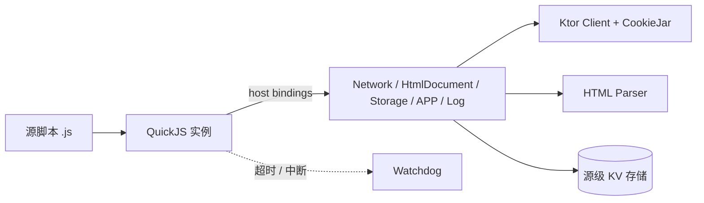

# 目标架构

> 状态：草案 · 2026-10-28
> 本文描述 Phase 1 之后的目标形态；Phase 0 只验证其中风险最高的三个假设，见 [Phase 0 计划](02-phase-0.md)。

## 1. 设计约束

- 一套数据层、一套源协议、一个播放器抽象；三种媒介的呈现层独立。
- Android 迁移期间必须持续可发布，不做"停机重写"。
- 不引入 GPL 代码；Aniyomi（Apache-2.0）可按模块搬运，Venera（GPL-3.0）只参考行为。
- 首发 Android + 桌面（Windows/macOS/Linux），iOS 后置。
- 本地文件、WebDAV、离线下载是一等公民，不依赖自建服务。

## 2. 系统上下文



## 3. 目标模块划分

```
:androidApp            Android 壳（初期基于 Aniyomi，逐步替换 UI）
:desktopApp            CMP 桌面壳
:iosApp                CMP iOS 壳（后置）

:shared:model           领域模型、媒体类型、进度语义
:shared:data            Room KMP schema、Repository、迁移
:shared:network         Ktor/平台 HTTP、Cookie、缓存
:shared:source-api      Kotlin 侧源接口、manifest、能力声明
:shared:source-runtime  QuickJS 宿主、沙箱、Venera 兼容层
:shared:library         收藏、历史、分类、聚合搜索
:shared:download        下载队列、断点、文件命名
:shared:sync            WebDAV 同步、冲突合并
:shared:reader-comic    漫画阅读器（视图 + loader 管线）
:shared:reader-novel    小说排版引擎（分页、字体、主题）
:shared:reader-video    播放会话、进度、字幕
:shared:ui              CMP 设计系统、通用组件、导航
```

Phase 1 不一次性建全；按"core → 单媒介 → 单平台"的顺序落地。Android 现有模块在对应模块稳定前保留。

## 4. 数据模型（草案）

所有媒介共享库与进度，但进度载荷按媒介区分。

```text
library_item
  id, media_type(comic|novel|video), source_id, source_key,
  title, cover_url, author, description, status,
  added_at, updated_at, last_viewed_at

media_entry                      -- 章节或剧集
  id, item_id, kind(chapter|episode), idx, title, url,
  uploaded_at, scanlator, metadata_json

progress
  item_id, entry_id, position_kind(page|scroll|timestamp),
  position_value, duration, updated_at, device_id

source
  id, kind, name, version, api_version, enabled, manifest_json

download_task
  id, item_id, entry_id, state, progress, total_bytes,
  file_path, error, created_at, updated_at

history
  id, item_id, entry_id, viewed_at, device_id
```

原则：

- `media_type` 只影响呈现与进度解析，不影响库的公共查询。
- 进度写入幂等，按 `(item_id, device_id)` 合并；同步采用按条 last-write-wins + 墓碑删除。
- 源数据（Cookie、登录）不进同步；只同步库、进度、分类、设置白名单。

## 5. 源协议

### 5.1 Kotlin 接口（宿主侧）

```kotlin
enum class MediaType { COMIC, NOVEL, VIDEO }

interface SourceDescriptor {
    val id: String
    val name: String
    val type: MediaType
    val version: String
    val apiVersion: Int
}

interface ComicSource : SourceDescriptor {
    suspend fun search(query: String, page: Int, options: Map<String, String>): Paged<ComicSummary>
    suspend fun details(id: String): ComicDetails
    suspend fun entries(id: String): List<Entry>
    suspend fun pages(entryId: String): List<PageRef>
}
```

`NovelSource` 用章节正文替代图片；`VideoSource` 单独设计（hoster、提取器、字幕轨道），不与漫画源强行同构。**待验证**：视频源是否在 v1 开放给 JS，或先内置少量通用解析器。

### 5.2 Manifest 与版本

```json
{
  "id": "example.comic",
  "name": "Example",
  "type": "comic",
  "apiVersion": 1,
  "version": "1.0.0",
  "minAppVersion": "0.1.0",
  "entry": "source.js"
}
```

- `apiVersion` 由宿主定义，源声明支持范围；不兼容时拒绝加载而不是静默失败。
- 源仓库是索引 JSON + 脚本 URL，用户手动添加；不内置、不推荐。
- 每个源独立 KV 存储、Cookie 容器、超时与内存配额。

### 5.3 Venera 兼容层

- 目标：让现有 Venera `ComicSource` 格式的脚本在**只读子集**上直接运行。
- 实现方式：宿主实现 `Network`、`HtmlDocument`、源存储、`Comic`/`ComicDetails` 等数据类与生命周期契约；**按文档独立实现，不复制 `assets/init.js` 或运行时源码**。
- 明确不支持：UI 对话框、评论、网络收藏等交互能力的首版可用性，先 stub 并显式报错。
- 许可证边界见 [ADR-0004](adr/0004-licensing-and-clean-room.md)。

## 6. JS 运行时



- 引擎：`quickjs-kt`（Android/JVM/Native）优先；若 alpha 版本的稳定性不达标，退化为 vendor `quickjs-ng` + expect/actual。
- 执行：每个源独立实例；操作在后台调度器运行；支持超时、取消、死循环中断。
- 权限：无文件系统、无原始 socket、无宿主反射；网络仅通过受控 `Network` API。
- 限额：单次操作超时（建议 30s）、单源内存上限、存储配额、响应体大小上限；超限即终止并记录。
- 兼容：先实现读路径（搜索/探索/详情/章节/图片），交互能力后置。

## 7. 播放器

- 抽象：`mediamp`（Apache-2.0，pre-1.0）；Android 用 ExoPlayer，桌面用 MPV，iOS 用 AVKit。
- 宿主只依赖统一 API；后端差异放进 `PlayerCapabilities`，不假设三端完全一致。
- 必须显式验证：外部字幕（SRT/ASS 样式）、HLS、续播、缓冲策略、后台播放、画中画、硬件解码、HDR。
- 已知限制：mediamp 当前 Linux 仅 x86_64；pre-1.0 API 可能破坏性变更。
- 回退：若 Phase 0 验证失败，Android 暂时保留 Aniyomi 的 mpv 播放器，桌面/iOS 另选后端；这会增加平台差异，需重新评估。

## 8. 阅读器

### 漫画

- 复用 Aniyomi 的 loader 管线：HTTP、下载、压缩包、目录、EPUB。
- 视图层重新实现：分页（LTR/RTL/纵向）、长条连续、双页拆分、预取、转场、缩放、墨水屏刷新。
- `ReaderViewModel` 与 `ChapterLoader` 是主要迁移对象；`Viewer`/`Pager`/`SubsamplingScaleImageView` 不直接迁移。

### 小说

- 章节正文 → 排版引擎（分页、字距/行距、字体、主题、边距）→ 阅读视图。
- 首版支持 TXT/EPUB；在线书源复用 `NovelSource` 能力。
- 避免 WebView 排版：性能与一致性不可控。

### 视频

- 播放会话与进度、手势、字幕、扩展按钮；与 Aniyomi 播放器的功能差距在 S1 中量化。
- 视频源的 hoster/提取器复杂度最高，v1 范围需单独确认。

## 9. 同步与存储

- WebDAV 同步 v1：库、进度、分类、设置白名单；按条合并，冲突取最新并保留墓碑。
- 本地数据库：Room KMP 2.8 + bundled SQLite；Android/JVM 共用，iOS 后续接入（[ADR-0009](adr/0009-room-kmp-data-layer.md)）。
- 文件：下载目录按 `源/作品/章节/页码` 组织；本地导入保持只读索引，不搬移用户文件。
- 备份：导出/导入 JSON + 数据库快照；与 Aniyomi 备份格式的兼容性作为可选目标。

## 10. 迁移策略（Strangler）

| 阶段 | Android | 桌面 | 共享层 |
|---|---|---|---|
| Phase 0 | 不动 | S3 样例 | 无 |
| Phase 1 | 加 `:shared:core` 与 JS 源（feature flag） | 空壳 | model/data/source-runtime |
| Phase 2 | 旧 UI 继续发版 | CMP 壳 + 迁移后的屏幕 | ui/reader-comic |
| Phase 3 | 逐屏替换为 CMP | 小说 + 视频 | reader-novel/reader-video |
| Phase 4 | 完成切换 | 稳定 | iOS 复用 |

规则：

- 任意时刻只有一个源引擎在正式路径上；APK 扩展最多作为 Android 过渡兼容层，设明确移除日期。
- 每次迁移一个屏幕/一个能力，保持主干可发布。
- 共享模块不依赖 Android API；平台能力走 expect/actual。

## 11. 平台矩阵

| 平台 | UI | 播放后端 | 状态 |
|---|---|---|---|
| Android 8+ | CMP（迁移期混合） | ExoPlayer (mediamp) | 首发 |
| Windows x64/arm64 | CMP | MPV (mediamp) | 首发 |
| macOS x64/arm64 | CMP | MPV (mediamp) | 首发 |
| Linux x64 | CMP | MPV (mediamp) | 首发（ARM64 暂缺） |
| iOS | CMP | AVKit (mediamp) | Phase 4 |

## 12. 非功能需求

- 冷启动：中端 Android 设备 < 2s 进入可交互库页。
- 滚动：1,000 项网格稳定 60fps（桌面）/ 无明显掉帧（中端 Android）。
- 内存：阅读 2,000px 宽长图不 OOM；图片缓存可配置上限。
- 离线：飞行模式下本地库、已下载内容、阅读进度完整可用。
- 隐私：默认无遥测；崩溃日志本地保存，用户手动导出。
- 国际化：中/英首发；文案不硬编码在 UI 组件。
- 可访问性：字号缩放、对比度、键盘导航（桌面）。

## 13. 待验证假设

| 假设 | 验证方式 | 失败后果 |
|---|---|---|
| mediamp 三端功能足够 | S1 | 换播放后端或暂缓视频 |
| QuickJS KMP 稳定且够快 | S2 | vendor QuickJS / 缩小 JS 源范围 |
| Aniyomi Compose 屏可低成本迁移 | S3 | 放弃 fork，改新建 CMP 壳 |
| MD3E 在 CMP 可用 | S3 | 退回 M3 标准组件 |
| Venera 源兼容可清洁实现 | S2 | 自定义源格式，接受生态冷启动 |
