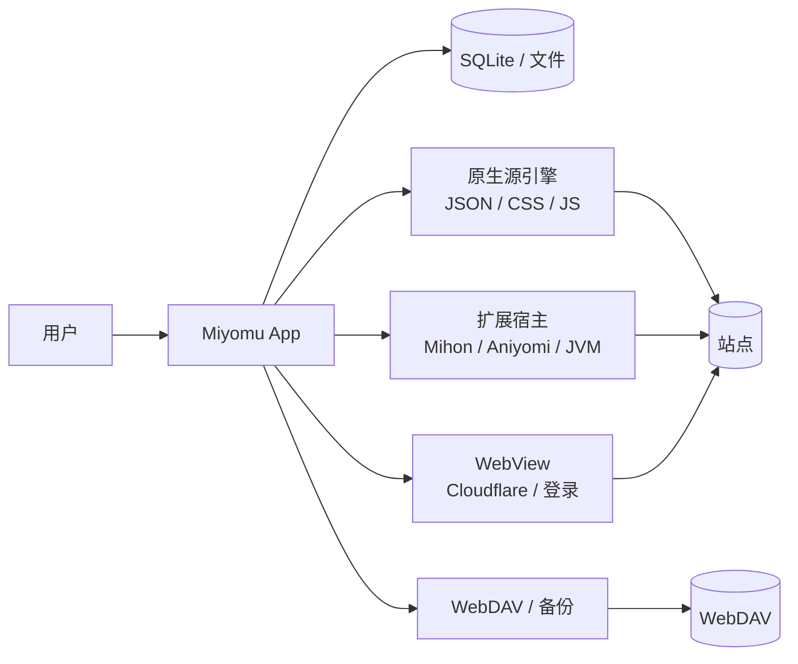
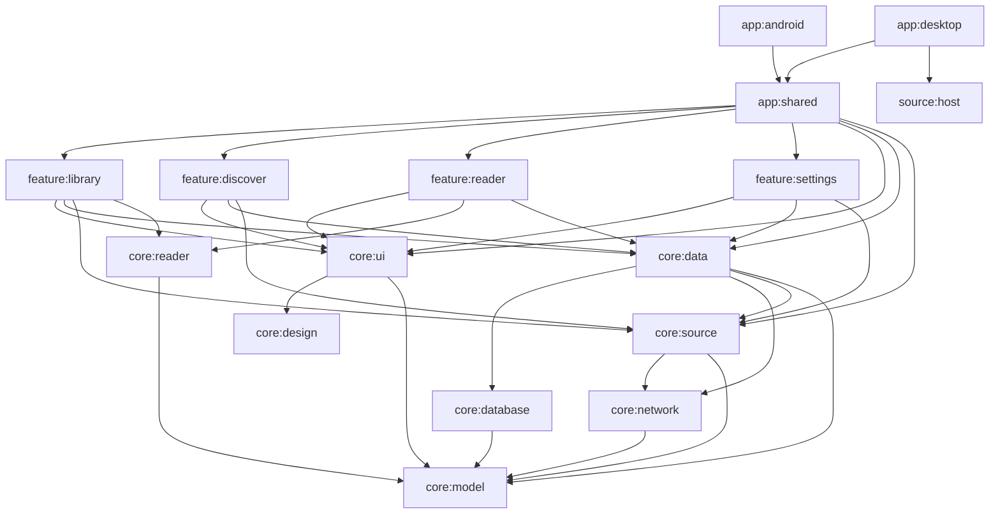
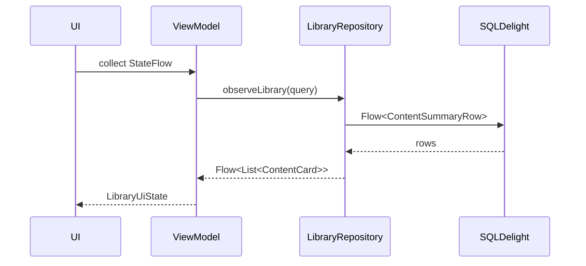
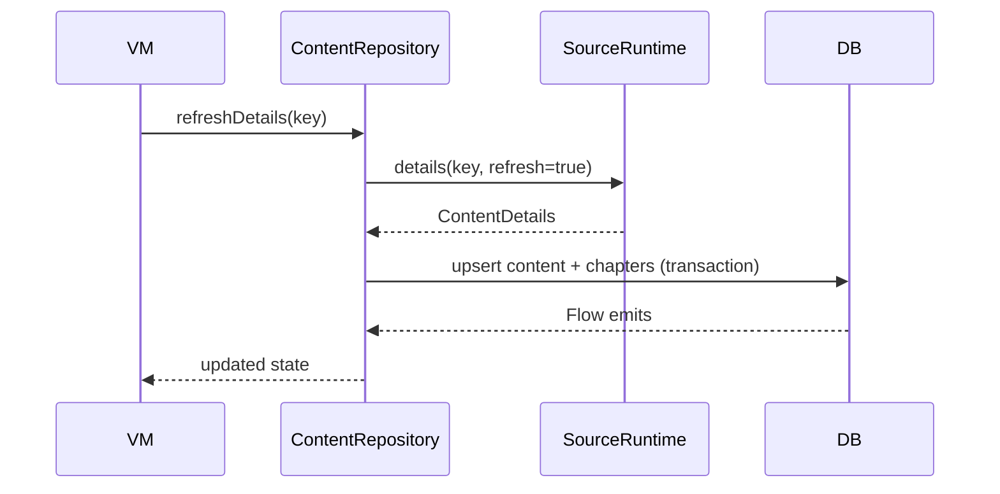

# 02 · 架构设计

> **方向修正（2026-10-31）：** 本文为初稿，部分结论已被 [07-架构优先方案](07-architecture-first.md) 与 [08-MD3E 设计系统](08-md3e-design.md) 取代。冲突处以后两者为准。

> **按 07 的修正：** 模块数量、数据库（Room）、ID（Long）、DI（新模块 Koin）与迁移顺序以 07 为准；本文的 SourceRuntime/阅读器/缓存/测试思路可继续参考。

> 目标：用尽量少的模块，建立可执行的边界；让“加一个源”“加一个页面”“加一个平台”都只改一处。

## 1. 设计原则

1. **本地优先（local-first）**：数据库是唯一事实来源；UI 读数据库，网络只负责刷新与补全。
2. **契约先行**：`SourceRuntime`、`ContentKey`、`ChapterKey`、`ReaderScene`、`ProgressAnchor` 先冻结，再写实现。
3. **平台是边缘**：共享层不知道 Android/iOS/Desktop；平台差异通过 `expect/actual` 或能力接口注入。
4. **单向数据流**：UI 发送 `Action`，ViewModel 产生新 `UiState`；UI 不直接调用 Repository。
5. **不可变状态**：所有 UI state 使用不可变集合/数据类；Compose 编译器能跳过就跳过。
6. **显式失败**：错误是返回值/密封类型，不用异常穿透 UI；每个错误有类别、可重试性、用户文案。
7. **能力可声明**：平台/源支持什么，用布尔能力表达；UI 对“不支持”有专门空态。
8. **先纵切后横向**：每个里程碑必须能完整走通一条用户路径。

## 2. 系统上下文



## 3. 模块结构

### 3.1 模块清单（17 个，含 build-logic）

```text
miyomu/
├── app/
│   ├── shared/        # KMP 组合根：App()、导航、DI、平台 actual
│   ├── android/       # Android 壳：Activity、Manifest、权限
│   └── desktop/       # Desktop 壳：main、窗口、打包
├── iosApp/            # iOS Xcode 壳：ComposeUIViewController
├── core/
│   ├── model/         # 纯模型、ID、序列化 DTO、错误
│   ├── database/      # SQLDelight schema、查询、迁移
│   ├── network/       # Ktor client、Cookie、请求策略
│   ├── source/        # SourceRuntime、Registry、原生源引擎
│   ├── data/          # Repository、同步、下载、设置
│   ├── reader/        # 纯 Kotlin 阅读器几何/进度/小说排版
│   ├── design/        # 颜色、字体、形状、图标、基础组件
│   └── ui/            # 自适应壳、导航、通用列表/卡片/空态
├── feature/
│   ├── library/       # 首页、书库、历史、更新、下载、书签
│   ├── discover/      # 浏览、搜索、来源、详情
│   ├── reader/        # 漫画/小说/视频阅读与播放 UI
│   └── settings/      # 设置、源管理、外观、同步、关于
├── source/
│   └── host/          # JVM 扩展宿主（Desktop 可选）
├── build-logic/       # convention plugins
└── docs/
```

### 3.2 依赖图



依赖规则（CI 用 Gradle 依赖报告 + Detekt 自定义规则检查）：

| 规则 | 说明 |
| --- | --- |
| `core:*` 不得依赖 `feature:*` / `app:*` | 核心层不知道页面 |
| `feature:*` 不得互相依赖 | 功能之间通过导航参数/共享 model 通信 |
| `feature:*` 不得依赖 `app:shared` | 组合根只向下依赖 |
| `core:model` 不依赖任何项目模块 | 纯 Kotlin |
| `core:reader` 不依赖 Compose/Android/网络 | 纯几何，可在 JVM/iOS 单测 |
| `core:database` 不依赖 `core:source` | schema 不知道运行时 |
| 只有 `app:shared` 能装配 Koin 全量图 | 平台壳只启动 |
| 只有 `app:*` 能依赖平台 SDK | 共享层不出现 `android.*` / `UIKit` / `java.awt` |

### 3.3 各模块职责

#### `core:model`

- `SourceId`、`ContentKey`、`ChapterKey`、`PageKey`
- `ContentType`、`ContentRating`、`ContentState`
- `ContentSummary`、`ContentDetails`、`Chapter`、`Page`
- `Progress`、`ProgressAnchor`、`UpdateEvent`
- 序列化 DTO 与 `SourceDescriptor` / `SourceCapability`
- `AppError`、`Outcome`
- 不包含数据库映射、网络、UI。

#### `core:database`

- SQLDelight `.sq` / `.sqm`
- `MiyomuDatabase` 工厂
- 查询与投影 `ContentSummaryRow`
- 事务、迁移、FTS（可选）
- 不做业务判断。

#### `core:network`

- Ktor `HttpClient` 工厂（平台引擎）
- 默认 UA、超时、重试、代理、Cookie
- `SourceHttpClient`：按源注入 headers/Cookie/Referer
- DoH 可选；Cloudflare 检测接口
- 不包含站点解析。

#### `core:source`

- `SourceRuntime` 契约
- `SourceRegistry` / `SourceFactory`
- 原生源引擎（manifest、CSS、JSONPath、JS bridge）
- 扩展源适配器接口（Android/JVM 实现放 `app:shared` 平台源集或 `source:host`）
- 源偏好树、动态筛选
- 源调用上下文、限流、诊断
- 不直接写数据库。

#### `core:data`

- Repository：`LibraryRepository`、`ContentRepository`、`SourceRepository`、`DownloadRepository`、`SettingsRepository`、`BackupRepository`、`SyncRepository`
- 事务边界、缓存策略、进度合并、更新检测
- 下载队列/文件存储（平台执行器注入）
- `platform/` 下的纯接口：`FilePicker`、`SecureStore`、`BackgroundScheduler`、`Notifier`、`Sharer`、`PlayerEngine`
- 数据层测试。

> 平台接口放在 `core:data` 的 `platform` 包，而不是新建模块：feature 已经依赖 data，`app:shared` 负责 actual 绑定；这样既不把 Android/UIKit 带进 core，也不增加一个只有接口的空模块。

#### `core:reader`

- `ReaderScene` / `PagedScene` / `ContinuousScene`
- `ReaderMode`、`ReaderModeDetection`
- `ProgressAnchor`、`ReaderController`
- `ImagePipeline` 的计划部分（`DecodePlan`、`TileGrid`）
- 小说文档块、EPUB 文本解析、分页切行
- 不依赖 Compose。

#### `core:design`

- `MiyomuTheme`、颜色/字体/形状/间距 token
- 基础组件：按钮、卡片、Chip、空态、进度、封面、图标
- 设计 token 的 golden 测试
- 不含业务。

#### `core:ui`

- `AdaptiveAppScaffold`、导航栏/侧栏/底栏
- 顶层目的地与通用路由
- 通用列表/网格、选择栏、筛选抽屉、搜索框
- 共享的空态/错误态/加载态
- `PlatformCapabilities` 的 UI 投影（哪些入口显示/隐藏）
- 不直接依赖 Repository。

#### `feature:*`

- 页面 + ViewModel + UiState + Action
- 只依赖 core，不依赖其他 feature
- 页面组合共享组件；平台能力从 `PlatformCapabilities` 读取。

#### `app:shared`

- `MiyomuApp()` 根 Composable
- `NavHost` 与路由装配
- Koin modules 装配
- 平台 `actual`：文件选择、播放器、WebView、安全存储、通知、后台任务
- 启动流程、深链、崩溃处理。

#### `app:android` / `app:desktop` / `iosApp`

- 只做平台入口与打包配置。
- Android：`MainActivity`、`Application`、Manifest、权限、`WorkManager` 初始化。
- Desktop：`main()`、窗口、菜单、托盘、文件关联、打包。
- iOS：`iosApp/` Xcode 工程消费 `app:shared` 的 `MiyomuShared.framework`，入口是 `ComposeUIViewController`，Swift 只负责 App 生命周期与原生桥。

#### `source:host`

- 独立 JVM 进程，加载 Mihon/Aniyomi/Tsundoku/JAR 扩展。
- JSON-RPC/JSONL 协议，进程级隔离。
- dex2jar/AndroidCompat 可选。
- 不进入 Android/iOS 构建。

## 4. 身份模型

### 4.1 为什么不用裸 Long

Kototoro 使用 `Long` 作为 parser ID，并通过 `MIHON_{id}` 等前缀区分来源。这在单进程内可行，但跨源、跨设备同步、不同扩展版本之间容易出现碰撞/漂移。

Miyomu 使用复合键：

```kotlin
@JvmInline
value class SourceId(val value: String)

data class ContentKey(
    val source: SourceId,
    val remoteId: String,
)

data class ChapterKey(
    val content: ContentKey,
    val remoteId: String,
)
```

### 4.2 SourceId 的稳定格式

```text
native:<manifest-id>                 # 原生 JSON 源
mihon:<packageName>:<sourceId>       # Mihon 扩展
aniyomi:<packageName>:<sourceId>     # Aniyomi 扩展
tsundoku:<packageName>:<sourceId>    # Tsundoku 扩展
jar:<pluginId>:<sourceName>          # Kotatsu/UMA/JAR
local:<uuid>                         # 本地导入（不同步）
```

约定：

- `SourceId` 一旦发布不可变；manifest 升级不得改 id。
- `remoteId` 优先使用源提供的稳定 ID；没有则使用规范化 URL 的 SHA-256 前 16 字节。
- `ChapterKey` 的 `remoteId` 同样优先源 ID；Mihon 用章节 URL 作为 fallback。
- 同步只同步 `syncable = true` 的源；本地源不同步。

### 4.3 展示 ID

UI/路由不直接拼字符串。使用 `ContentKey.encode()` / `decode()`：

```text
miyomu://content?source=native%3Aexample&id=abc
```

数据库仍存两列，便于索引与 Join。

## 5. SourceRuntime 契约

### 5.1 核心接口

```kotlin
interface SourceRuntime : AutoCloseable {
    val ref: SourceRef
    val descriptor: SourceDescriptor

    suspend fun browse(query: BrowseQuery): BrowsePage
    suspend fun search(query: SearchQuery): BrowsePage
    suspend fun details(key: ContentKey, refresh: Boolean): ContentDetails
    suspend fun chapters(key: ContentKey, refresh: Boolean): List<Chapter>
    suspend fun pages(key: ChapterKey): List<Page>
    suspend fun image(page: Page): ImageResource

    // 可选能力：默认抛 Unsupported
    suspend fun chapterText(key: ChapterKey): RichText? = throw Unsupported()
    suspend fun related(key: ContentKey): List<ContentSummary> = emptyList()
    suspend fun preferences(): PreferenceScreen = PreferenceScreen.Empty
    suspend fun updatePreference(update: PreferenceUpdate): PreferenceResult = PreferenceResult.Unsupported
    suspend fun browserSession(origin: String): BrowserSession? = null

    override fun close() = Unit
}
```

设计取舍：

- **不把 `getSources()` 放进 runtime**：一个 runtime 实例对应一个源；源列表由 `SourceRegistry` 管理。
- **不把 `getPageUrl()` 单独暴露**：`Page` 已包含 URL/headers；需要二次解析的源在 `pages()` 内完成。
- **`image()` 返回 `ImageResource`**（URL + headers + 可选字节流），平台图片加载器决定如何取。
- **`AutoCloseable`**：扩展 runtime 可能持有 ClassLoader/客户端；关闭即释放。
- **可选能力用默认实现**：不强迫每个源实现偏好/浏览器/相关作品。

### 5.2 DTO

```kotlin
data class BrowseQuery(
    val page: Int = 0,
    val order: String? = null,
    val filter: SourceFilter = SourceFilter(),
    val query: String? = null,
)

data class BrowsePage(
    val items: List<ContentSummary>,
    val hasNext: Boolean,
    val nextPage: Int? = null,
)

data class ContentSummary(
    val key: ContentKey,
    val title: String,
    val coverUrl: String?,
    val largeCoverUrl: String?,
    val authors: List<String>,
    val rating: Float?,
    val contentType: ContentType,
    val contentRating: ContentRating,
    val state: ContentState?,
    val tags: List<String>,
    val source: SourceRef,
    val description: String? = null,
)

data class ContentDetails(
    val summary: ContentSummary,
    val altTitles: List<String>,
    val url: String,
    val publicUrl: String?,
    val chapters: List<Chapter>,
    val related: List<ContentSummary> = emptyList(),
    val metadata: JsonObject? = null,
)
```

### 5.3 SourceRegistry

```kotlin
interface SourceRegistry {
    fun observeSources(): Flow<List<SourceRef>>
    suspend fun refresh()
    suspend fun runtime(source: SourceId): SourceRuntime
    suspend fun test(source: SourceId): SourceTestReport
}
```

- 注册表合并：内置原生源、用户导入 JSON 源、已安装扩展源、本地源。
- 每个源一个 `SourceEntry`（元数据 + 工厂 + 启用状态）。
- runtime 按 `SourceId` 缓存，带空闲回收；扩展 runtime 由宿主进程管理。
- 源启用/禁用持久化在数据库，不放在 DataStore（需要与备份一起同步）。

### 5.4 调用上下文

```kotlin
data class SourceCallContext(
    val requestId: String,
    val timeout: Duration = 30.seconds,
    val allowCache: Boolean = true,
)

class SourceCallException(
    val source: SourceId,
    val requestId: String,
    val category: SourceErrorCategory,
    cause: Throwable? = null,
) : Exception(cause)
```

- 每次源调用生成 requestId，日志/诊断只记录类别与耗时，不记录 URL 参数、Cookie、正文。
- 每个 host 一个 `Semaphore(4)`；同一源的写操作（偏好）用 `Mutex`。
- 超时/取消必须协作；Ktor/OkHttp 取消传播。

### 5.5 适配器

| 适配器 | 位置 | 说明 |
| --- | --- | --- |
| `NativeSourceRuntime` | `core:source` | JSON/CSS/JS manifest |
| `LocalSourceRuntime` | `core:source` | CBZ/ZIP/EPUB/TXT/视频目录 |
| `MihonSourceRuntime` | Android `app:shared` / Desktop `source:host` | JVM 扩展 |
| `AniyomiSourceRuntime` | 同上 | 视频扩展 |
| `TvBoxSourceRuntime` | `core:source` | CMS/TVBox JSON |
| `CloudStreamRuntime` | 可选 | 后期 |

所有适配器只实现 `SourceRuntime`；上层不关心生态。

## 6. 数据库设计

### 6.1 原则

- 干净 v1，不背历史迁移。
- 列表查询只读投影；禁止 N+1。
- 复合主键 `(source_id, remote_id)`；章节再加 `chapter_remote_id`。
- 软删除只用于同步表；普通删除直接删。
- 所有时间戳使用 epoch millis（UTC）。
- JSON 只存源特有的、不参与查询的字段。

### 6.2 表清单

| 表 | 主键 | 作用 |
| --- | --- | --- |
| `source` | `id` | 源注册表、启用状态、排序、配置 |
| `content` | `(source_id, remote_id)` | 内容元数据 |
| `content_tag` | `(source_id, remote_id, tag)` | 标签（可查询） |
| `chapter` | `(source_id, content_remote_id, remote_id)` | 章节 |
| `chapter_page_cache` | `(source_id, content_remote_id, chapter_remote_id, page_index)` | 页面列表缓存（可选） |
| `favourite` | `(source_id, remote_id)` | 收藏状态、置顶、排序 |
| `category` | `id` | 收藏分类 |
| `favourite_category` | `(source_id, remote_id, category_id)` | 多对多 |
| `history` | `(source_id, remote_id)` | 最后阅读位置 |
| `update_event` | `id` | 更新事件（按章节身份去重） |
| `track` | `(source_id, remote_id)` | 更新检查状态 |
| `download` | `chapter_key` | 下载章节状态 |
| `download_page` | `(chapter_key, page_index)` | 下载页文件 |
| `bookmark` | `id` | 书签/笔记 |
| `reading_session` | `id` | 阅读时长统计 |
| `extension` | `id` | 已安装扩展 |
| `extension_repo` | `id` | 扩展仓库 |
| `search_history` | `query` | 搜索历史 |
| `tombstone` | `(entity, key)` | 同步删除标记 |
| `sync_state` | `key` | 上次同步游标/版本 |

`settings` 不放在数据库，使用 DataStore；需要跨设备同步的设置单独白名单。

### 6.3 关键列

```sql
content(
  source_id TEXT NOT NULL,
  remote_id TEXT NOT NULL,
  title TEXT NOT NULL,
  alt_titles TEXT NOT NULL DEFAULT '',
  url TEXT NOT NULL,
  public_url TEXT,
  cover_url TEXT,
  large_cover_url TEXT,
  description TEXT,
  authors TEXT,              -- \u001f 分隔，避免 JSON 查询
  state TEXT,
  rating REAL,
  content_type TEXT NOT NULL,
  content_rating TEXT NOT NULL,
  metadata_json TEXT,
  last_fetched_at INTEGER NOT NULL,
  updated_at INTEGER NOT NULL,
  PRIMARY KEY(source_id, remote_id)
);

chapter(
  source_id TEXT NOT NULL,
  content_remote_id TEXT NOT NULL,
  remote_id TEXT NOT NULL,
  title TEXT,
  number REAL,
  volume INTEGER,
  url TEXT NOT NULL,
  scanlator TEXT,
  branch TEXT,
  uploaded_at INTEGER,
  page_count INTEGER,
  metadata_json TEXT,
  PRIMARY KEY(source_id, content_remote_id, remote_id),
  FOREIGN KEY(source_id, content_remote_id)
    REFERENCES content(source_id, remote_id) ON DELETE CASCADE
);

history(
  source_id TEXT NOT NULL,
  remote_id TEXT NOT NULL,
  chapter_remote_id TEXT,
  page INTEGER NOT NULL DEFAULT 0,
  scroll REAL NOT NULL DEFAULT 0,
  percent REAL NOT NULL DEFAULT 0,
  chapters_count INTEGER NOT NULL DEFAULT 0,
  updated_at INTEGER NOT NULL,
  PRIMARY KEY(source_id, remote_id),
  FOREIGN KEY(source_id, remote_id)
    REFERENCES content(source_id, remote_id) ON DELETE CASCADE
);
```

### 6.4 索引

| 表 | 索引 | 用途 |
| --- | --- | --- |
| `content` | `(content_type, updated_at)` | 书库筛选/排序 |
| `content` | `(title)` | 搜索/排序 |
| `chapter` | `(source_id, content_remote_id, number)` | 章节列表 |
| `chapter` | `(uploaded_at)` | 更新检测 |
| `favourite` | `(category_id, pinned, created_at)` | 收藏页 |
| `history` | `(updated_at)` | 历史页 |
| `update_event` | `(discovered_at)` / `(read_at)` | 更新时间轴 |
| `track` | `(last_check_at)` | 后台刷新 |
| `download` | `(state)` | 下载队列 |
| `bookmark` | `(source_id, remote_id, created_at)` | 书签 |

### 6.5 列表投影

```sql
-- 书库卡片只读这些列；不 Join 章节
SELECT c.source_id, c.remote_id, c.title, c.cover_url, c.content_type,
       c.content_rating, c.state, h.percent, h.updated_at,
       f.pinned, f.created_at,
       (SELECT COUNT(*) FROM update_event e
         WHERE e.source_id = c.source_id AND e.remote_id = c.remote_id
           AND e.read_at = 0) AS new_chapters
FROM content c
LEFT JOIN history h ON ...
LEFT JOIN favourite f ON ...
WHERE ...
ORDER BY ...
LIMIT :limit OFFSET :offset;
```

规则：

- 列表页不加载 `chapter` 行。
- 新章节数用批量聚合，不逐条查询。
- 每个列表查询必须有 `EXPLAIN QUERY PLAN` 快照。
- 复杂筛选（标签/来源/进度/下载）用 `EXISTS` 子查询 + 索引，不用内存过滤全库。

### 6.6 迁移

- `schemaVersion = 1`。
- 任何已发布变更 → `.sqm` + `verifyMigrations` + 迁移回放测试。
- 备份格式独立版本号；恢复时先迁移到当前 schema。
- 不做“自动删库重建”；迁移失败给出可导出的诊断。

## 7. Repository 与数据流

### 7.1 读路径



### 7.2 刷新路径



### 7.3 写路径

- 所有多表写入在一个 `transaction {}` 内。
- 收藏/分类/进度/更新事件由 `core:data` 统一处理，不由页面直接写 DAO。
- 进度保存：`ProgressSaver` 合并短时间内的多次写入，退出/暂停时强制 flush。
- 更新检测：批量读取 favourite/track，按源分组，并发受限；只写增量事件。

### 7.4 Repository 契约

```kotlin
interface LibraryRepository {
    fun observeLibrary(query: LibraryQuery): Flow<PagingData<ContentCard>>
    fun observeContent(key: ContentKey): Flow<ContentDetails?>
    fun observeHistory(limit: Int): Flow<List<HistoryCard>>
    fun observeUpdates(filter: UpdateFilter): Flow<PagingData<UpdateGroup>>

    suspend fun setFavourite(key: ContentKey, favourite: Boolean)
    suspend fun setCategories(key: ContentKey, categoryIds: Set<Long>)
    suspend fun saveProgress(anchor: ProgressAnchor)
    suspend fun markChapterRead(key: ChapterKey, read: Boolean)
}

interface ContentRepository {
    suspend fun refreshDetails(key: ContentKey, force: Boolean): Outcome<ContentDetails>
    suspend fun chapters(key: ContentKey, force: Boolean): Outcome<List<Chapter>>
    suspend fun pages(key: ChapterKey): Outcome<List<Page>>
    suspend fun image(page: Page): Outcome<ImageResource>
}
```

## 8. 阅读器架构

### 8.1 分层

```text
┌─────────────────────────────────────────────┐
│ feature:reader (Compose UI, gestures, chrome)│
├─────────────────────────────────────────────┤
│ core:reader (scene, progress, mode, layout) │
├─────────────────────────────────────────────┤
│ core:data (page source, downloads, cache)   │
├─────────────────────────────────────────────┤
│ platform (decode, display, input)           │
└─────────────────────────────────────────────┘
```

### 8.2 场景模型

```kotlin
enum class ReaderMode { PAGED_LTR, PAGED_RTL, DOUBLE_PAGE, VERTICAL, WEBTOON, HORIZONTAL }

interface ReaderScene {
    val mode: ReaderMode
    val pageCount: Int
    val totalExtent: Float
    fun visiblePages(viewport: ReaderViewport): List<VisiblePage>
    fun anchorFor(viewport: ReaderViewport): ProgressAnchor
    fun viewportFor(anchor: ProgressAnchor, viewport: ReaderViewport): Float
}
```

- `PagedScene`：按视口步长分槽，支持单页/双页/RTL/宽图独占。
- `ContinuousScene`：纵向/横向连续，按可见范围加载。
- `WebtoonScene`：零间隙纵向长条，宽度适配。
- `ReaderModeDetection`：取 30% 处页面，`width * 1.8 < height` 判为条漫。

### 8.3 进度锚点

```kotlin
data class ProgressAnchor(
    val chapter: ChapterKey,
    val pageIndex: Int,
    val inPageOffset: Float,
    val percent: Float,
    val updatedAt: Long,
)
```

- 保存 page + 页内偏移，不只保存 percent。
- 跨章连续阅读时，历史记录当前章 + 偏移；返回时恢复。
- 章节最后一页才算“读完”；跳过章节不算读完。
- 退出、切后台、暂停时 flush；滚动中节流写入。

### 8.4 图片管线

1. `PageSource` 返回 URL + headers。
2. `ImageRequest` 带目标尺寸（视口宽高 × 缩放级别）。
3. 内存缓存（Coil）→ 磁盘缓存（Coil）→ 网络。
4. 超大图/长图：`DecodePlan` 决定是否分块；`TileGrid` 生成可见 tile。
5. 预取：当前页 ±2，章末预取下一章第 1 页；连续模式按可见范围。
6. 取消：离开页面/快速滑动时取消过期请求。
7. 预算：单页解码内存上限、总像素预算、并发解码数（建议 2）。

### 8.5 阅读器 UI

- `ReaderScaffold`：内容区 + 顶部 chrome + 底部进度 + 侧面板。
- 点击区域可配置（左/中/右/上/下）。
- 手势：单击、双击缩放、双指缩放、拖动、边缘滑动（可关）。
- 键盘：←/→、PageUp/PageDown、Space、F、Esc、+/-、B（书签）。
- 桌面：鼠标滚轮翻页/滚动、右键菜单、全屏。
- 手机：沉浸式状态栏/导航栏，刘海安全区。
- 平板/折叠：双页、跨 hinge、可配置单/双栏。

## 9. UI 架构

### 9.1 根结构

```kotlin
@Composable
fun MiyomuApp(container: AppContainer) {
    MiyomuTheme {
        val appState = rememberAppState(container)
        AdaptiveAppScaffold(
            destinations = appState.destinations,
            current = appState.currentDestination,
            onNavigate = appState::navigate,
        ) {
            NavHost(appState.navController, startDestination = HomeRoute) {
                composable<HomeRoute> { HomeScreen(...) }
                composable<LibraryRoute> { LibraryScreen(...) }
                // ...
            }
        }
    }
}
```

### 9.2 自适应

| 断点 | 宽度 | 导航 | 内容 |
| --- | --- | --- | --- |
| Compact | < 600dp | 底部栏（≤5） | 单栏 + sheet |
| Medium | 600–839dp | 导航栏（rail） | 单栏/可选双栏 |
| Expanded | 840–1199dp | 永久 rail | 列表-详情双栏 |
| Large | ≥ 1200dp | 侧栏 232dp | 列表 + 内容 + 上下文栏 |

- 用 `material3-adaptive` 的 `ListDetailPaneScaffold` / `SupportingPaneScaffold`。
- 不用 `if (isDesktop)` 写页面分支；用 `WindowSizeClass` + 能力。
- 桌面详情页在双栏中显示时，列表仍保持滚动位置。

### 9.3 状态

```kotlin
data class LibraryUiState(
    val query: String = "",
    val filter: LibraryFilter = LibraryFilter(),
    val sort: LibrarySort = LibrarySort.Recent,
    val selection: Set<ContentKey> = emptySet(),
    val items: ImmutableList<ContentCard> = persistentListOf(),
    val isLoading: Boolean = false,
    val error: UiError? = null,
)

sealed interface LibraryAction {
    data class Search(val query: String) : LibraryAction
    data class ToggleSelection(val key: ContentKey) : LibraryAction
    data class SetSort(val sort: LibrarySort) : LibraryAction
    // ...
}
```

- `ViewModel` 暴露 `StateFlow<UiState>` + `onAction`。
- 一次性事件（导航、Snackbar）用 `Channel<UiEvent>` / `SharedFlow`。
- 不在 Composable 里做业务计算；派生状态用 `remember`/`derivedStateOf`。

## 10. 依赖注入

```kotlin
val appModule = module {
    single<Database> { createDatabase(get()) }
    single<LibraryRepository> { DefaultLibraryRepository(get(), get()) }
    single<SourceRegistry> { DefaultSourceRegistry(get(), get()) }
    viewModel { LibraryViewModel(get(), get()) }
}

val platformModule = module {
    single<FilePicker> { PlatformFilePicker() }
    single<PlayerEngineFactory> { PlatformPlayerFactory() }
    single<SecureStore> { PlatformSecureStore() }
}
```

- `app:shared` 启动 Koin；平台 actual 在各自 source set 绑定。
- 不在 feature 里定义全局单例；feature 只声明自己的 ViewModel module。
- 测试用 `koin-test` 或直接构造。

## 11. 并发与生命周期

- 应用级 `CoroutineScope(SupervisorJob() + Dispatchers.Default)`；数据库/网络在 `Dispatchers.IO`。
- ViewModel scope 随导航销毁；长任务（下载、同步）用应用级 scope + 持久化队列。
- 源调用：按源限流，按 host 限流；取消传播到 Ktor/OkHttp。
- 数据库：SQLDelight 事务；写操作串行化到单一线程/actor，避免 `database is locked`。
- 下载：每章一个 job，队列状态持久化；进程重启恢复。
- 同步：单飞（mutex），失败退避，不在前台阻塞。

## 12. 错误模型

```kotlin
sealed interface AppError {
    val retryable: Boolean
    data class Network(val cause: Throwable) : AppError { override val retryable = true }
    data class Http(val code: Int) : AppError { override val retryable = code >= 500 }
    data class Parse(val source: SourceId) : AppError { override val retryable = false }
    data class Challenge(val origin: String) : AppError { override val retryable = true }
    data class Unsupported(val feature: String) : AppError { override val retryable = false }
    data class Storage(val cause: Throwable) : AppError { override val retryable = false }
    data class Cancelled(val cause: Throwable? = null) : AppError { override val retryable = true }
    data class Unknown(val cause: Throwable) : AppError { override val retryable = false }
}
```

- Repository 返回 `Outcome<T>`（`Success` / `Failure`）。
- UI 把 `AppError` 映射为文案 + 操作（重试/打开浏览器/换源/报告）。
- 不把异常消息直接展示给用户；详细错误进诊断日志。

## 13. 缓存策略

| 层 | 内容 | 失效 |
| --- | --- | --- |
| L1 内存 | 图片、当前列表、页面元数据 | LRU / 离开页面 |
| L2 磁盘 | Coil 图片缓存、下载页、CBZ | 预算/LRU |
| L3 数据库 | 内容、章节、历史、收藏、更新 | 手动刷新/TTL |
| 源缓存 | 详情 6h、章节 15m、页面列表 24h | 手动刷新绕过 |

- 离线时返回 DB 数据并标记 `stale`；不把空结果当成功。
- 刷新失败保留旧数据，显示“上次更新于 …”。
- 列表分页缓存只保留最近 N 页，避免内存膨胀。

## 14. 平台边界

| 能力 | 接口 | Android | Desktop | iOS |
| --- | --- | --- | --- | --- |
| 文件选择 | `FilePicker` | SAF | AWT/JFileChooser | UIDocumentPicker |
| 图片解码 | `ImageDecoder` | BitmapFactory/ImageDecoder | Skia | Skia |
| 视频 | `PlayerEngine` | Media3 | libmpv | AVPlayer |
| WebView | `BrowserView` | WebView | WebView2/WKWebView | WKWebView |
| 后台任务 | `BackgroundScheduler` | WorkManager | 协程 + 托盘 | BGTask |
| 通知 | `Notifier` | Notification | 托盘/系统通知 | UNNotification |
| 安全存储 | `SecureStore` | Keystore | Keychain/Credential Manager/libsecret | Keychain |
| 分享 | `Sharer` | Intent | 剪贴板/系统分享 | UIActivityViewController |
| 生物识别 | `Biometrics` | BiometricPrompt | Touch ID/Windows Hello | LocalAuthentication |

`PlatformCapabilities` 由各平台在启动时提供；UI 用它决定是否显示入口/空态。

## 15. 安全

- **扩展**：安装前展示来源、签名、哈希；默认禁止未知仓库；桌面宿主独立进程；Android 扩展与主进程同权限，必须明确警告。
- **JS 源**：沙箱只暴露允许的 API；禁止文件系统/任意 JVM 反射；执行超时。
- **密钥**：只进 `SecureStore`；日志/诊断脱敏；备份默认不含密码。
- **Cookie**：按源隔离；加密存储；退出登录/删除源时清理。
- **NSFW**：内容分级 + 来源级覆盖 + 无痕阅读；搜索/推荐可过滤。
- **网络安全**：默认禁明文 HTTP；允许用户为特定源开启；不全局关闭证书校验。
- **隐私**：默认无分析 SDK；崩溃报告可选且脱敏。

## 16. 可观测性

- `Kermit` 统一日志；tag 为模块名；release 只保留 WARN+。
- 结构化事件：`source.call`、`db.query`、`reader.page`、`download.task`、`sync.run`，字段包含耗时、结果、requestId。
- 源诊断环形缓冲（最近 200 条），可导出 JSON；不含 URL 参数/Cookie/正文。
- 启动耗时、首帧、DB 初始化、源注册耗时打点；debug 面板可见。
- 崩溃：平台原生崩溃收集 + Kotlin 异常边界；可选 Sentry/Bugsnag，默认关闭。

## 17. 测试策略

| 层 | 工具 | 重点 |
| --- | --- | --- |
| `core:model` / `core:reader` | JUnit5 + Kotest property | 几何、进度、模式检测、边界 |
| `core:database` | SQLDelight migration test | v1→vN、查询计划、索引 |
| `core:source` | Ktor MockEngine + fixtures | 解析、分页、错误、超时 |
| `core:data` | fakes + Turbine | 合并、缓存、N+1、事务 |
| `feature:*` | Compose UI test | 关键路径、空态、无障碍 |
| 设计系统 | Golden/Paparazzi/Roborazzi | 颜色、字体、组件 |
| 性能 | Macrobenchmark / JMH | 启动、滚动、翻页、DB |
| 端到端 | 平台 UI test | 导入源→阅读→离线→恢复 |

**查询计数测试**：对书库/历史/更新等列表，用测试 driver 记录 SQL 次数，超过预算即失败。这是防止 Kototoro 式 N+1 的关键门禁。

## 18. 构建与 CI

- Gradle 9.7 + AGP 9.3.1 + Kotlin 2.4.21。
- `build-logic` convention plugins。
- CI 矩阵：
  - Linux：Android assemble + unit tests + detekt/ktlint。
  - macOS：iOS framework + simulator tests + desktop package。
  - Windows：desktop package + JVM tests。
- 缓存：Gradle、Kotlin/Native、Xcode DerivedData。
- 发布：GitHub Releases；Android APK/AAB；macOS DMG；Windows MSI/ZIP；Linux deb/AppImage；iOS 未签名 IPA（侧载）。
- 版本：`major.minor.patch`；数据库 schema 与备份格式独立版本。

## 19. 与 Kototoro 的架构差异

| 维度 | Kototoro | Miyomu |
| --- | --- | --- |
| 模块 | ~30，app 巨大 | 17，feature 清晰 |
| UI | Android/Desktop 共享，iOS SwiftUI | 三端共享 Compose |
| DB | Room KMP，86 迁移 | SQLDelight，干净 v1 |
| DI | Hilt + 手动 | Koin |
| 导航 | Navigation3 + 自定义桌面 | Navigation Compose KMP + Adaptive |
| 源 | 8 生态一次性支持 | 原生 → Mihon → 其他 |
| 扩展 | Android 进程内 + iOS JVM | Android 进程内 + Desktop 独立进程；iOS 不做 |
| 性能 | 事后审计 | 预算 + 查询计数 + benchmark 门禁 |
| 视觉 | 玻璃/渐变/多套卡片 | Sumi 设计系统，内容优先 |

## 20. 架构决策记录

- [ADR-0001：KMP + Compose Multiplatform](adr/0001-kmp-compose.md)
- [ADR-0002：SQLDelight](adr/0002-sqldelight.md)
- [ADR-0003：SourceRuntime 与复合 ID](adr/0003-source-runtime.md)
- [ADR-0004：自适应单一 UI](adr/0004-adaptive-ui.md)
