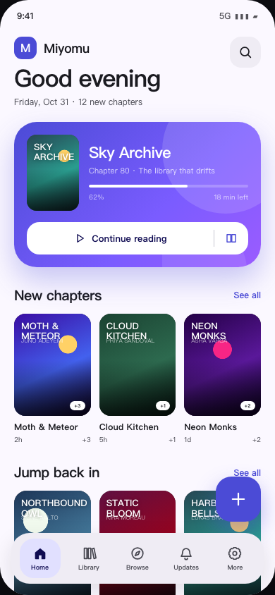
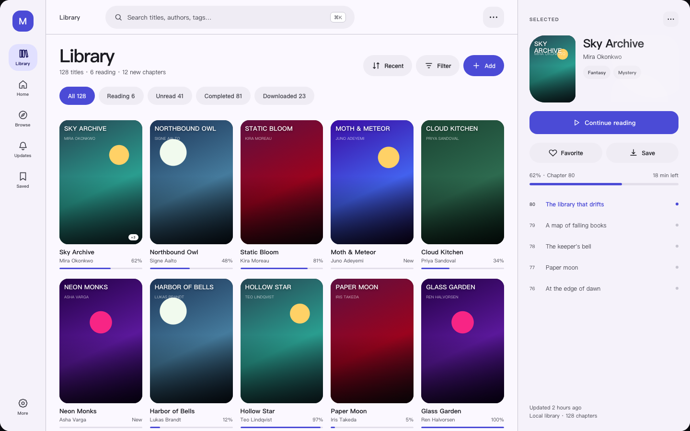
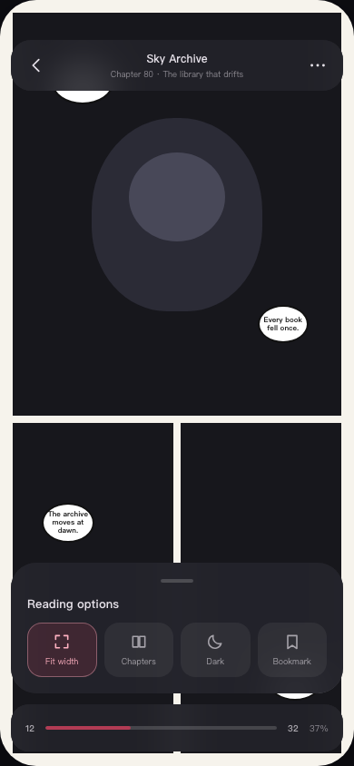

# 08 · MD3E 设计系统

> Material 3 Expressive（MD3E）不是“给旧页面换颜色”。它是一套关于**色彩、形状、字体、动效、组件**的完整表达方式。
> 本文定义 Miyomu 的 MD3E 方向；原型与 Compose 组件都必须从这里取 token。

## 1. 为什么是 MD3E

Kototoro 的旧 UI 是“Android 平板布局 + 玻璃拟态 + 多套卡片”的混合体。它的信息架构不差，但视觉语言不统一，桌面端也缺少真正的桌面交互。

MD3E 适合 Miyomu 的原因：

- **表达力强**：大标题、鲜明色彩、形状变化，能让阅读器从“工具”变成有辨识度的产品。
- **自适应**：NavigationBar / Rail / Pane 的体系适合手机、平板、桌面。
- **动效内置**：弹簧、容器变换、共享元素，不需要自己造一套动画框架。
- **组件完整**：ButtonGroup、SplitButton、FABMenu、LoadingIndicator、Carousel、SearchBar、BottomSheet 覆盖主要场景。
- **跨平台**：Compose Multiplatform 的 Material3 版本已包含 MD3E API，Android/Desktop/iOS 可共用。

## 2. 设计原则

1. **大胆但克制**：一个屏幕只允许一个“表达性焦点”（大标题、彩色容器、形状 morph、FAB 菜单四选一）。
2. **内容优先**：封面和正文永远是最高对比；chrome 用 surface container，不与内容抢。
3. **形状有语义**：圆角/胶囊/shape morph 用来表达层级与状态，不做纯装饰。
4. **动效解释空间**：容器变换解释“从哪里来”，共享元素解释“到了哪里”，弹簧解释“操作反馈”。
5. **三端一致，交互不同**：视觉 token 一致；手机用触控/底栏，桌面用键盘/rail/右键。
6. **可降级**：减少动效、低性能模式、OLED、电子墨水都能退化到静态/高对比。

## 3. 色彩

### 3.1 策略

- Android：支持 **动态取色**（Material You），但保留品牌种子作为 fallback。
- Desktop/iOS：使用品牌色板，不跟随系统壁纸。
- 品牌种子：**Electric Indigo** `#5B5BD6`；辅助 **Coral** `#E85D75`；第三色 **Mint** `#2BB673`。
- 语义色：success/warning/danger 使用 MD3 角色，不直接复用品牌色。
- 阅读器内容区：中性 surface，不用高饱和背景；只有控件使用强调色。

### 3.2 角色示例（Light）

| 角色 | 值 | 用途 |
| --- | --- | --- |
| `primary` | `#4B4BD6` | 主操作、当前导航 |
| `onPrimary` | `#FFFFFF` | 主操作文字 |
| `primaryContainer` | `#E1E0FF` | 主操作容器 |
| `onPrimaryContainer` | `#0F0B52` | 容器文字 |
| `secondary` | `#B23B54` | 次强调/收藏 |
| `tertiary` | `#006B4F` | 成功/阅读进度 |
| `surface` | `#FBF8FF` | 页面底色 |
| `surfaceContainerLowest` | `#FFFFFF` | 最高层卡片 |
| `surfaceContainerLow` | `#F5F2FA` | 页面区块 |
| `surfaceContainer` | `#EFECF4` | 卡片/输入 |
| `surfaceContainerHigh` | `#E9E5EF` | 浮层 |
| `surfaceContainerHighest` | `#E3DFEA` | 选中/悬停 |
| `onSurface` | `#1B1B21` | 主文字 |
| `onSurfaceVariant` | `#46464F` | 次要文字 |
| `outline` | `#777680` | 边框 |
| `outlineVariant` | `#C7C5D0` | 分隔线 |
| `error` | `#BA1A1A` | 错误 |

### 3.3 角色示例（Dark）

| 角色 | 值 |
| --- | --- |
| `primary` | `#C0C1FF` |
| `onPrimary` | `#1B1B5E` |
| `primaryContainer` | `#3333A8` |
| `secondary` | `#FFB1C1` |
| `tertiary` | `#5BD6A8` |
| `surface` | `#131318` |
| `surfaceContainerLowest` | `#0D0D12` |
| `surfaceContainerLow` | `#1B1B21` |
| `surfaceContainer` | `#1F1F25` |
| `surfaceContainerHigh` | `#2A2930` |
| `surfaceContainerHighest` | `#35343B` |
| `onSurface` | `#E5E1E9` |
| `onSurfaceVariant` | `#C7C5D0` |
| `outline` | `#918F9A` |
| `outlineVariant` | `#46464F` |

### 3.4 使用规则

- 一个屏幕最多一个 `primaryContainer` 大色块（Hero/CTA）。
- 内容卡片用 `surfaceContainerLow`；浮层用 `surfaceContainerHigh`。
- 不用纯黑/纯白大面积；OLED 用 `surface = #000000`，容器用 `#0A0A0C`。
- 封面/海报不得叠加高饱和蒙层；用底部 scrim 保证文字对比。
- 动态色只改变品牌色相，不改变语义色（错误/成功/警告）。

## 4. 字体

### 4.1 MD3E 类型层级

| Token | 字号/行高 | 字重 | 用途 |
| --- | --- | --- | --- |
| `displayLarge` | 57/64 | 400 | 桌面空态/欢迎 |
| `displayMedium` | 45/52 | 400 | 大屏 Hero |
| `displaySmall` | 36/44 | 400 | 手机 Hero |
| `headlineLarge` | 32/40 | 600 | 页面标题 |
| `headlineMedium` | 28/36 | 600 | 区块标题 |
| `headlineSmall` | 24/32 | 600 | 卡片标题 |
| `titleLarge` | 22/28 | 600 | 顶栏/对话框 |
| `titleMedium` | 16/24 | 600 | 列表标题 |
| `bodyLarge` | 16/24 | 400 | 正文 |
| `bodyMedium` | 14/20 | 400 | 辅助 |
| `labelLarge` | 14/20 | 600 | 按钮 |
| `labelMedium` | 12/16 | 500 | 标签 |

- 中文标题使用 600，避免过细；英文可用 500–600。
- 数字（进度/页码/时间）使用 tabular figures。
- 阅读正文独立 token：`readingBody` 18/30，可选 serif；用户可调 14–24sp。
- 不内置超大 CJK 字体；使用系统字体 + 可选下载字体。

### 4.2 表达性用法

- Home 顶部使用 `displaySmall` / `headlineLarge`，配一句短文案。
- 详情页标题使用 `headlineLarge`，作者/来源用 `bodyMedium`。
- 按钮/标签使用 `labelLarge`，全大写仅用于极短英文标签。
- 不用 3 种以上字号在同一卡片内。

## 5. 形状

### 5.1 圆角

| Token | 值 | 用途 |
| --- | --- | --- |
| `extraSmall` | 4dp | 小标签 |
| `small` | 8dp | 输入框/小按钮 |
| `medium` | 12dp | 列表项 |
| `large` | 16dp | 卡片 |
| `largeIncreased` | 20dp | Hero 卡片 |
| `extraLarge` | 28dp | Sheet/大容器 |
| `extraLargeIncreased` | 32dp | FAB/对话框 |
| `full` | 999dp | 胶囊/头像 |

### 5.2 Shape morph

- 用于：选中导航项、FAB 展开、加载态、空态插画、详情封面容器。
- 不用于：每个卡片、每个按钮、滚动中的列表（性能/视觉噪音）。
- 形状来自 `MaterialShapes`（cookie/clover/sunny 等），但只作为**强调**，不替代常规圆角。
- 形变时长 300–500ms，使用 expressive spring；减少动效时直接切换。

## 6. 动效

- 使用 `MotionScheme.expressive()`；不要手写固定 `tween` 作为主运动。
- 标准时长：200–300ms；容器变换：350–450ms；FAB 菜单：300ms。
- 关键动效：
  1. 封面 → 详情：shared bounds + container transform。
  2. 列表 → 阅读器：淡入 + 轻微 scale，避免大幅位移。
  3. FAB → 快捷操作：FABMenu 展开。
  4. 筛选/排序：ButtonGroup 选中态 shape morph。
  5. 加载：`LoadingIndicator` 的 MD3E 形状动画。
- 支持“减少动态效果”：关闭共享元素/弹簧，只保留 120ms 淡入。
- 不在长列表滚动时做逐项动画。

## 7. 组件

### 7.1 导航

| 场景 | 组件 |
| --- | --- |
| 手机 | `ShortNavigationBar` / `NavigationBar`（3–5 项） |
| 平板 | `NavigationRail` + `ListDetailPaneScaffold` |
| 桌面 | 展开 `NavigationRail`（240dp）+ 顶部 `Toolbar` |
| 阅读器/视频 | 浮动 `Toolbar`，自动隐藏 |

- 顶层：Home、Library、Browse、Updates、More。
- 桌面侧栏可展开来源快捷列表、存储状态、设置。
- 选中态用 `primaryContainer` + 形状 morph；不使用底部小圆点。

### 7.2 操作

- `Button`：filled / tonal / outlined / text / elevated。
- `ButtonGroup`：筛选、排序、分段选择；组内单选/多选。
- `SplitButton`：主操作 + 下拉（如“继续阅读” + 章节选择）。
- `FAB`：大号浮动操作（搜索/继续阅读/新建）；`FABMenu` 展开快捷操作。
- `IconButton`：40/48dp；桌面 32/40dp + hover。
- `SegmentedButton`：视图切换（网格/列表）。
- `Chip`：标签/筛选；选中态用 `secondaryContainer`。
- `Badge`：新章节/下载数量。

### 7.3 内容

- `Card`：filled / elevated / outlined；书库卡片用 `surfaceContainerLow`，不叠厚重阴影。
- `Carousel`：Home Hero/新章节横向；支持 snap。
- `ListItem`：设置/章节/来源；leading icon + title + supporting text + trailing。
- `SearchBar`：展开式，输入即搜索；桌面 Cmd/Ctrl+K。
- `BottomSheet`：筛选/阅读选项/章节；MD3E 大圆角 + drag handle。
- `Dialog`：确认/输入；避免全屏对话框。
- `Snackbar`：短反馈 + 撤销。
- `LoadingIndicator`：页面/图片加载；列表用 skeleton。
- `Tooltip`：桌面图标按钮。

### 7.4 阅读器/播放器

- 顶部/底部 `FloatingToolbar`，背景 `surfaceContainer` 80% 不透明 + blur 可选（默认关）。
- 进度条使用 MD3E slider；章节 tick。
- 选项 sheet 使用 ButtonGroup + Slider + Switch。
- 播放器控件：播放/暂停、进度、音轨/字幕、倍速、全屏；浮动工具栏。

## 8. 自适应布局

| 断点 | 宽度 | 导航 | 内容 |
| --- | --- | --- | --- |
| Compact | < 600dp | ShortNavigationBar | 单栏 + sheet + FAB |
| Medium | 600–839dp | NavigationRail | 单栏/可选 list-detail |
| Expanded | 840–1199dp | NavigationRail | list-detail + supporting pane |
| Large | ≥ 1200dp | 展开 rail 240dp | 列表 + 内容 + 上下文栏 |

- 使用 `material3-adaptive`：`ListDetailPaneScaffold`、`SupportingPaneScaffold`。
- 桌面详情页：左元数据、右章节，两个独立滚动区。
- 平板/折叠：hinge 安全区；双页阅读。
- 手机横屏：rail + 双栏，不拉伸底栏。

## 9. 页面方向

### Home

- 顶部大标题 + 日期 + 搜索。
- **Continue Reading Hero**：大圆角容器、封面、标题、进度、SplitButton（继续 + 章节）。
- 新章节 Carousel。
- 最近添加网格。
- FABMenu：导入本地 / 添加源 / 搜索。
- 空态：大标题 + 两个操作 + MaterialShapes 插画。

### Library

- 顶栏：标题 + 数量 + 搜索/筛选。
- ButtonGroup：All / Reading / Unread / Completed / Downloaded。
- 网格/列表 SegmentedButton。
- 卡片：封面、标题、进度、Badge；选中态用 checkbox + tonal overlay。
- 多选：TopAppBar 变选择模式；底部操作栏。
- 桌面：左列表 + 右详情；右键菜单。

### Browse

- 来源卡片/列表；固定/最近/全部。
- 来源详情：头部 + ButtonGroup 排序/筛选 + 结果网格。
- 筛选 BottomSheet；桌面用 supporting pane。
- 来源管理入口。

### Details

- 封面 Hero + container transform；动态色从封面提取（低饱和）。
- SplitButton：继续阅读 + 章节下拉。
- ButtonGroup：书签/下载/分享。
- 进度卡、简介、标签、章节列表。
- 桌面：左信息、右章节；章节独立滚动。
- 手机：底部固定 CTA。

### Reader

- 内容区中性；chrome 用 MD3E floating toolbar。
- 顶部：返回、标题、章节、更多。
- 底部：进度、页码、章节、显示。
- 选项 sheet：ButtonGroup（模式）、Slider（字号/亮度）、Switch（方向/裁边）。
- 手势/键盘/触控与平台一致；减少动效可关。

### Video

- 全屏视频 + 浮动控制层。
- 轨道/字幕/倍速用 BottomSheet。
- 手势：双击播放/暂停、左右滑进度、上下滑音量/亮度。
- 桌面：键盘快捷键 + 右键菜单。

### Downloads / Sync / Settings / Extensions

- MD3E ListItem + Card；分组用 `surfaceContainerLow`。
- 设置搜索；危险操作确认。
- 下载队列：进度、暂停/继续、批量。
- 同步：WebDAV 配置、备份预览、恢复。
- 扩展：仓库、安装、启用、源测试。

## 10. 桌面与 iOS

### 桌面

- 侧栏 240dp，可折叠；顶部 command bar；Cmd/Ctrl+K。
- 右键菜单、hover、focus ring、拖放导入。
- 快捷键：←/→ 翻页、Space 播放/下一页、F 全屏、B 书签、Esc 关闭。
- 窗口最小 1024×700；记忆位置/大小。

### iOS

- Compose UI；底部 NavigationBar；sheet detents；边缘返回手势。
- 原生：AVPlayer、WKWebView、UIDocumentPicker、UIActivityViewController。
- 触觉反馈；动态岛/安全区适配。
- 阅读器内禁用边缘返回，避免与翻页冲突。

## 11. 可访问性

- 触控 ≥ 48dp；桌面 ≥ 32dp + 8dp 间距。
- 对比度：正文 4.5:1；大字号 3:1；焦点环 3:1。
- 文字缩放 200% 不截断；卡片标题最多 2 行。
- 屏幕阅读器：封面“标题，作者，进度，N 个新章节”；阅读器“第 x 页，共 y 页”。
- 动效：尊重减少动态效果；不闪烁。
- 颜色：状态配图标/文字，不只靠颜色。

## 12. 性能约束

- MD3E 的 blur/大阴影默认关闭；需要时提供“性能模式”。
- 不为每个列表项做 shape morph；只对选中/加载/关键操作使用。
- 图片按目标尺寸解码；网格不加载大图。
- 长列表单层 Lazy；禁止嵌套同方向滚动。
- 阅读器预取可关；低内存自动降级。
- 目标：60fps；翻页 < 16ms/帧；冷启动 < 1.2s（中端 Android）。

## 13. 当前原型（第一版方向）

静态原型：[`design/md3e/prototype.html`](../design/md3e/prototype.html)

这一版只验证三件事：**MD3E 的色彩/形状/字体方向、手机与桌面的信息层级、阅读器浮动控件**。它不是最终视觉，也不是可交互产品。

> 原型中的封面、标题、作者均为虚构演示数据；实际实现用 Compose + Coil，不使用 HTML。

### 原型计划（并行）

原型不是最终交付，但必须与架构同步推进：

| 阶段 | 原型 | 验收 |
| --- | --- | --- |
| D0 | 色彩/字体/形状/动效 token | 与 Compose 主题一致 |
| D1 | Home / Library / Details | 手机 + 桌面两版 |
| D2 | Reader / Video | 手势/控件/暗色 |
| D3 | Settings / Downloads / Sync | 列表/表单/危险操作 |
| D4 | 平板/iOS 适配 | 断点/安全区 |
| D5 | 全量走查 | 与实现截图对比 |

原型文件放在 `design/md3e/`；每张稿标注：断点、状态（loading/empty/error）、交互说明。

## 14. 与旧 Sumi 方向的关系

- `docs/04-ui-ux-design.md` 中的 Sumi 方向**作废**，仅保留响应式布局/阅读器部分的思路。
- 新的权威设计文档是本文。
- 旧原型 `design/prototype.html` 仅作布局参考，不采用其配色/玻璃/字体。

## 15. MD3E 验收清单

- [ ] `MaterialExpressiveTheme` + `MotionScheme.expressive()` 生效。
- [ ] 动态色/品牌色在 Android/Desktop/iOS 都正确。
- [ ] 至少使用 3 个 MD3E 组件族（ButtonGroup、SplitButton、FABMenu、LoadingIndicator、ShortNavigationBar）。
- [ ] 形状 morph 只出现在关键交互，不造成滚动卡顿。
- [ ] 手机/平板/桌面三端导航正确切换。
- [ ] 阅读器/播放器控件不遮挡内容，自动隐藏。
- [ ] 减少动效/200% 字体/屏幕阅读器通过。
- [ ] 与原型截图对照，差异有记录。

## 16. 相关文档

- [07 · 架构优先方案](07-architecture-first.md)
- [ADR-0005：保留 Room KMP 与 Long ID](adr/0005-room-and-ids.md)
- [ADR-0006：架构优先的 Strangler 迁移](adr/0006-architecture-first.md)
- [MD3E 静态原型](../design/md3e/prototype.html)
