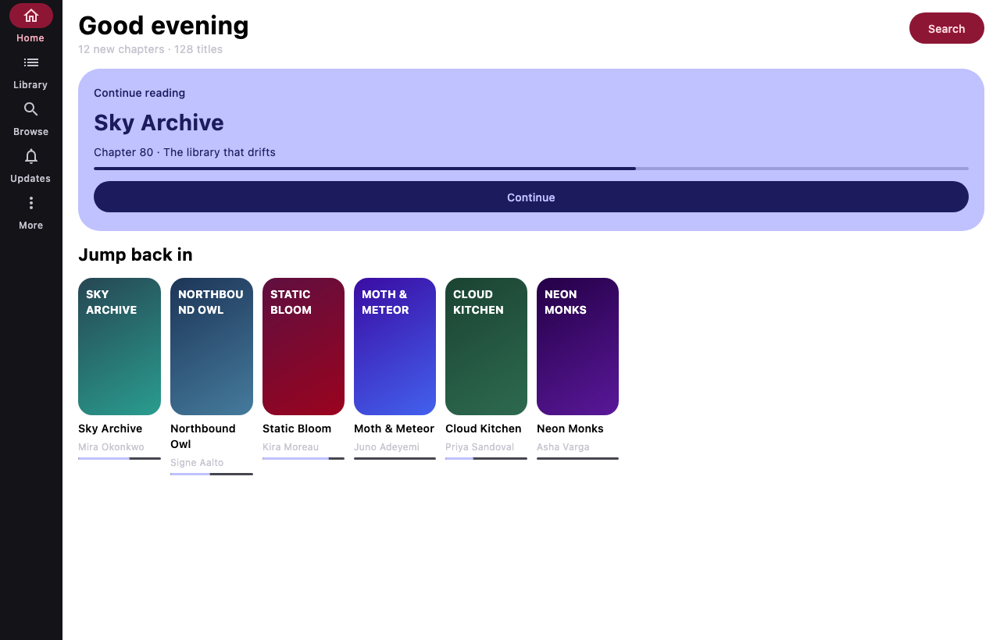
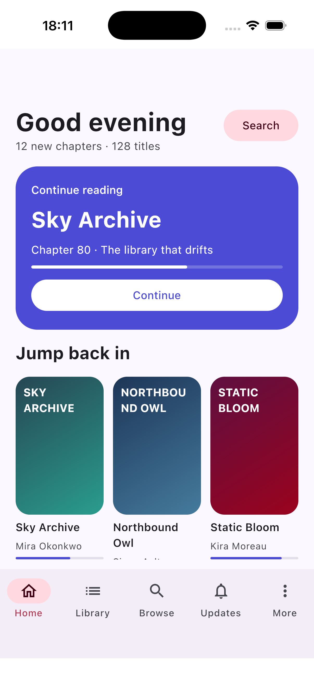

# 10 · P0 状态：三端骨架已跑通

日期：2026-10-31
阶段：P0（Baseline / Skeleton）

## 1. 已完成

| 项 | 状态 | 证据 |
| --- | --- | --- |
| Gradle 9.7 / Kotlin 2.4.21 / AGP 9.3.1 | ✅ | `./gradlew --version` |
| 20 个 Gradle 模块（app/core/feature/source） | ✅ | `./gradlew projects` |
| Android Debug APK | ✅ | `app/android/build/outputs/apk/debug/android-debug.apk`（约 15 MB） |
| Desktop Compose App | ✅ | `:app:desktop:run` 启动；`ScreenshotTest` 渲染 1280×820 |
| iOS framework + Xcode app | ✅ | `:app:shared:linkDebugFrameworkIosSimulatorArm64`；`xcodebuild` 成功 |
| MD3E 主题骨架 | ✅ | `MaterialExpressiveTheme` + `MotionScheme.expressive()` |
| Koin 依赖 | ✅ | `app:shared` 已引入 Koin Compose/ViewModel |
| Room KMP 占位库 | ✅ | `app_meta` 表；Android/Desktop/iOS KSP 生成并通过 |
| 自适应壳（底栏/rail） | ✅ | `core:ui` 的 `MiyomuAppShell` |
| 代码检查/CI | ⏳ | `.github/workflows/ci.yml` 已写，未在 GitHub 实跑 |
| build-logic 约定插件 | ⏳ | 尚未落地；当前模块直接写 build 配置 |
| 真实业务迁移 | ⏳ | P1 开始 |

## 2. 构建命令

```bash
./gradlew :app:android:assembleDebug
./gradlew :app:desktop:run
./gradlew :app:desktop:test --tests app.miyomu.desktop.ScreenshotTest
./gradlew :app:shared:linkDebugFrameworkIosSimulatorArm64

cd iosApp
xcodegen generate
xcodebuild -project Miyomu.xcodeproj -scheme Miyomu \
  -configuration Debug -sdk iphonesimulator \
  -destination 'platform=iOS Simulator,name=iPhone 17' \
  CODE_SIGNING_ALLOWED=NO build
```

## 3. 截图

Desktop（1280×820，`ScreenshotTest` 离屏渲染）：



iOS 模拟器（iPhone 17，iOS 26.5）：



## 4. 当前目录

```text
app/shared        KMP 组合根 + iOS framework
app/android       Android 壳
app/desktop       Desktop 壳
iosApp            XcodeGen 工程 + SwiftUI 壳
core/model        Long ID 值类、内容类型、错误
core/database     Room KMP 占位库
core/design       MD3E 主题/颜色/形状
core/ui           自适应壳/导航
core/network      依赖已接，代码待 P1
core/source       依赖已接，代码待 P1
core/reader       依赖已接，代码待 P1
core/data         依赖已接，代码待 P2
feature/*         占位页面（library/discover/reader/settings）
source/host       JVM 壳
```

## 5. 已知问题

1. **`androidLibrary {}` 弃用警告**：AGP 9.3 提示改用 `android {}`；当前可构建，P0.5 迁移。
2. **iOS 顶部安全区重复**：SwiftUI 已避让一次，`Scaffold` 又加了一次，出现较大空白；P5 统一 insets。
3. **导航是 `remember` 状态**：尚未接 Navigation Compose；P1 接路由/深链。
4. **Room 只是占位**：真实 `core-db`（35 表/86 迁移）在 P2 复制。
5. **UI 只是骨架**：没有真实数据、图片加载、阅读器；P1/P5 逐步替换。
6. **build-logic 未落地**：当前 20 个模块直接写配置；约定插件下一步做。
7. **没有真实 CI 运行**：workflow 已写，需推到 GitHub 验证。
8. **iOS 最低 18.0**：Xcode 链接时警告 framework 的 ICU 目标为 18.5；后续统一 deployment target。

## 6. 下一步 P1

按 [07-架构优先方案](07-architecture-first.md)：

1. 复制 `reader-core` → `:core:reader`，原测试通过。
2. 复制 `core-source` + `parser-api` 必要部分 → `:core:source`。
3. 复制 `core-net` → `:core:network`。
4. 复制 `core-backup` / `core-domain` → `:core:data`/`:core:model`。
5. 接一个 fixture 源，跑通“浏览→详情→章节→页面”最小链路。

### P1 前置

- 先决定 `build-logic`：是继续直接写模块配置，还是抽 2 个 convention plugin（建议抽）。
- 先修 iOS insets，否则后续页面会重复踩。
- 先加 Navigation Compose，否则 feature 路由会返工。

## 7. 结论

P0 的目标是“三端能构建、能启动、有统一主题、能继续往上加功能”。这一目标已达到。

下一步不是继续美化骨架，而是开始 **P1 的核心复制**：先把 Kototoro 的 `reader-core` / `core-source` / `core-net` 接进来，让真实数据流跑起来，再让 MD3E UI 消费它。
