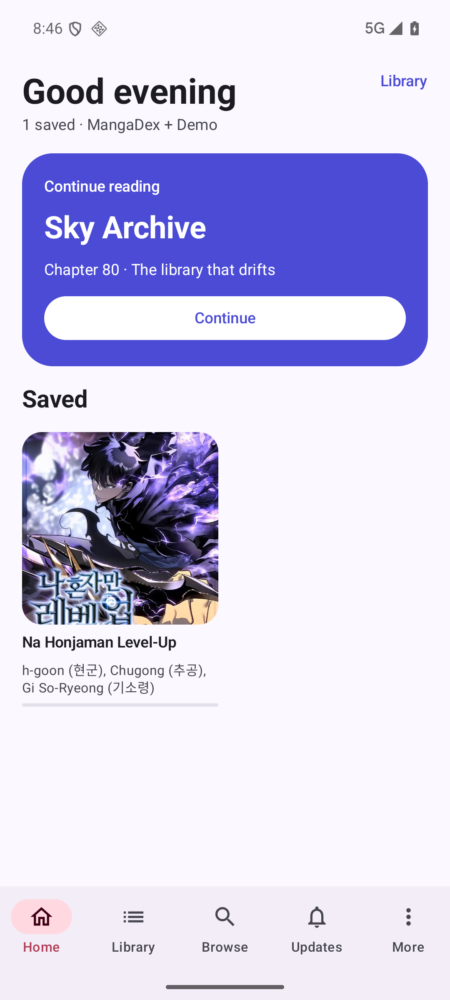
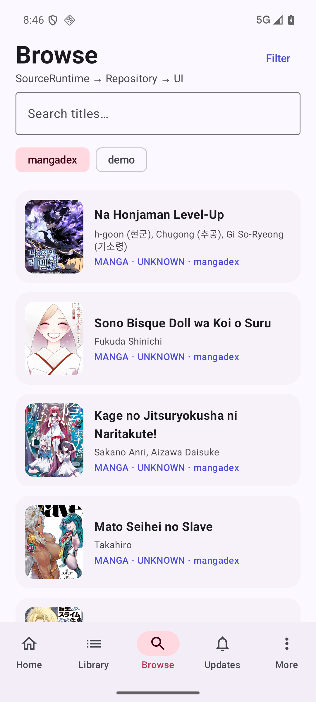
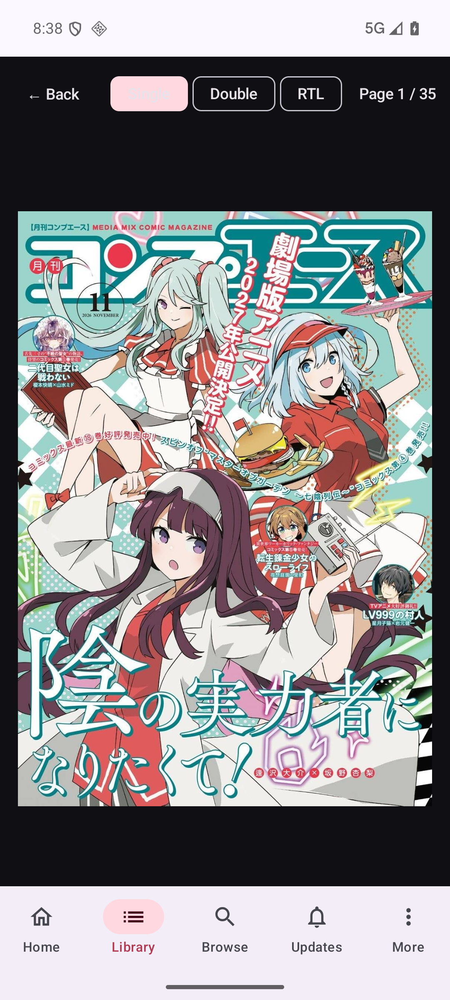
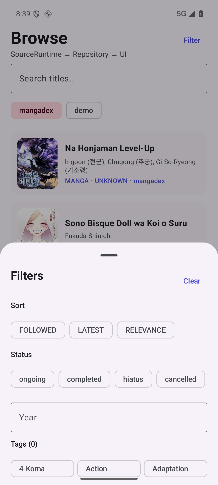
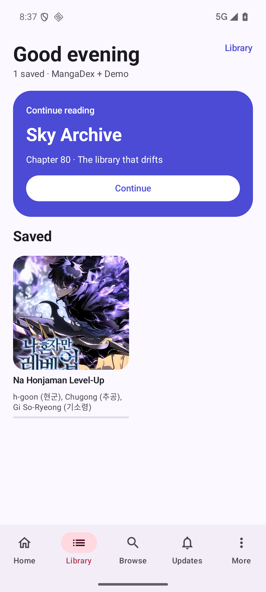
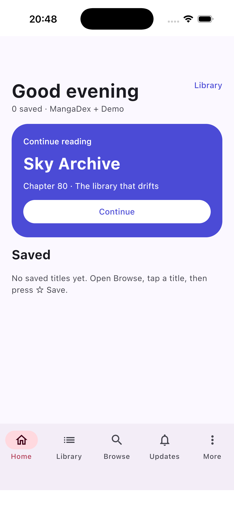

# 20 · P1 收尾与验收

日期：2026-10-31
状态：**P1 完成**

## 1. P1 验收清单

| 能力 | 结果 | 证据 |
| --- | --- | --- |
| Android 启动 | ✅ | `docs/screenshots/android-home.png` |
| iOS 启动 | ✅ | `docs/screenshots/ios-home.png` |
| 真实 MangaDex 列表 | ✅ | `docs/screenshots/android-browse.png` |
| 封面 Coil 加载 | ✅ | Browse/详情/收藏页 |
| 详情 + 章节 | ✅ | `docs/screenshots/android-details.png` |
| 阅读器页面图 | ✅ | `docs/screenshots/android-reader.png`（35 页） |
| 阅读进度恢复 | ✅ | 翻到 Page 2，退出重进仍是 Page 2 |
| 收藏 → Room → Library | ✅ | `docs/screenshots/android-library.png`（1 saved） |
| 源切换 + 搜索 | ✅ | Browse chips + 搜索框 |
| 筛选树 | ✅ | `docs/screenshots/android-filter.png`（排序/状态/年份/标签） |
| Reader 模式 | ✅ | Single / Double / RTL chips |
| 错误重试 | ✅ | Discover / Details / Reader |
| ViewModel 单测 | ✅ | 4 个（Reader 3 + Library 1） |
| Room 迁移测试 | ✅ | v1→v2 |
| Koin 新 API | ✅ | 无 deprecation warning |

## 2. Android 验收

设备：Android Emulator API 36（`han1me-16kb`）
包名：`app.miyomu.debug`（debug 后缀）
构建：

```bash
./gradlew :app:android:assembleDebug
adb install -r app/android/build/outputs/apk/debug/android-debug.apk
adb shell am start -n app.miyomu.debug/app.miyomu.android.MainActivity
```

人工路径：

1. Home；
2. Browse → MangaDex 列表（真实封面）；
3. Filter → 排序/状态/年份/标签；
4. 详情 → 章节；
5. 阅读器 → Page 1/35 → 滑到 Page 2；
6. 返回 → 重新进同一章 → Page 2；
7. ☆ Save → Library 出现该作品；
8. 重启 App → 收藏仍在。

## 3. iOS 验收

构建：

```bash
./gradlew :app:shared:linkDebugFrameworkIosSimulatorArm64
xcodebuild -project iosApp/Miyomu.xcodeproj -scheme Miyomu \
  -configuration Debug -sdk iphonesimulator \
  -destination 'platform=iOS Simulator,name=iPhone 17' \
  CODE_SIGNING_ALLOWED=NO build
xcrun simctl install booted /path/to/Miyomu.app
xcrun simctl launch booted app.miyomu
```

结果：启动成功，Home/底部导航正确显示。

## 4. 测试

```text
reader           193
source            76
network          105
data               5
database           1
feature:reader     3
feature:library    1
--------------------
total            384
```

关键新增：

- `MangaDexSourceRuntimeTest.sendsFilterParameters`
- `ReaderViewModelTest.switchesToDoubleAndRtlModes`
- `ReaderViewModelTest.restoresProgressForSameChapter`
- `LibraryViewModelTest.exposesFavouritesFromRepository`
- `MigrationTest.migratesV1ToV2AndCreatesNewTables`

## 5. 路由与状态

- `details/{sourceName}/{contentId}`
- `reader/{sourceName}/{contentId}/{chapterId}`
- 源名随路由传递，不再依赖全局选中源；
- ViewModel 由 `NavBackStackEntry` 作用域持有，配置变化后仍存活；
- Navigation 恢复路由参数；Direct `SavedStateHandle` 注入仍留给 P2（筛选草稿的进程死亡恢复）。

## 6. 本轮修复的运行时问题

Android 验收时发现并修复：

1. `ReaderViewModel` 在 `pages` 为空时 `IndexOutOfBoundsException`；
2. MangaDex 外部章节没有页面图，导致章节列表全空；
3. 详情页封面无限高，把描述/章节挤出屏幕；
4. 描述过长导致章节列表不可见；
5. MangaDex 429/5xx 没有重试；
6. 源切换是全局状态，详情/阅读器可能取错源。

## 7. P1 完成定义

- 三端可构建、可启动；
- Browse → Details → Reader 主链路可用；
- 真实源、图片、Room、ViewModel/Koin 全部接入；
- 收藏/进度可持久化并恢复；
- 源切换、搜索、筛选、Reader 模式有 UI；
- 关键路径有测试；
- Android 模拟器 + iOS 模拟器验收通过。

以上均满足。

## 8. 进入 P2

P2 优先项：

1. 源管理页（启用/排序/添加源）；
2. `SavedStateHandle`/进程死亡状态恢复；
3. 历史/搜索建议；
4. 下载、备份、同步；
5. 真机验收与性能。

## 9. 截图

### Android Home


### Android Browse


### Android Details


### Android Reader


### Android Filter


### Android Library


### iOS Home

